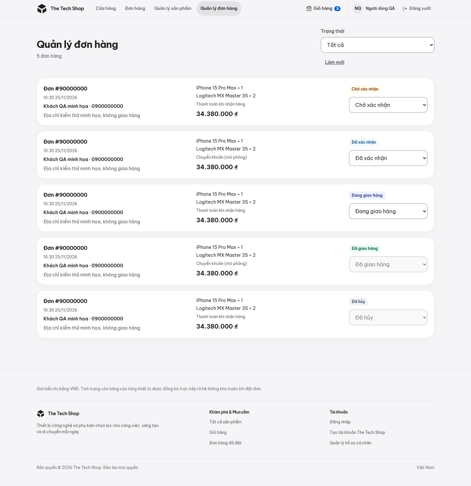

# The Tech Shop

Ứng dụng bán thiết bị công nghệ với React và Spring Boot. Khách có thể tìm sản phẩm, quản lý giỏ, đặt hàng và hủy đơn đang chờ xác nhận. Quản trị viên quản lý sản phẩm và xử lý đơn theo từng trạng thái.

Bản demo có 23 sản phẩm mẫu thuộc 6 danh mục. Giá, tồn kho và thanh toán chuyển khoản dùng dữ liệu minh họa.

**[Mở bản demo trên Render](https://the-tech-shop-storefront.onrender.com/)**

## Công nghệ

| Phần | Công nghệ |
| --- | --- |
| Backend | Java 17+, Spring Boot 3.2, Spring Security, JWT, BCrypt |
| Dữ liệu | PostgreSQL, Spring Data JPA, Flyway, MapStruct |
| Frontend | React 18, React Router, Vite 6, Tailwind CSS 4, Axios |
| Kiểm tra | JUnit 5, Mockito, kiểm thử API và trình duyệt trên dữ liệu QA |
| CI | GitHub Actions với hai job kiểm tra backend và build frontend |

## Tính năng

- Phân quyền CUSTOMER/ADMIN ở API và điều hướng tương ứng ở giao diện.
- Đăng ký với thông báo lỗi ngay khi nhập. Sau khi đăng nhập, chọn avatar để xem họ tên, email và vai trò.
- Đổi mật khẩu từ trang hồ sơ. Giao diện báo lỗi ngay khi nhập và server xác minh mật khẩu hiện tại trước khi lưu.
- Tìm kiếm, lọc danh mục, sắp xếp và phân trang phía máy chủ.
- Nhập số lượng trực tiếp hoặc dùng nút tăng/giảm. Backend kiểm tra tồn kho và tính tiền.
- Đặt hàng trong transaction, lưu giá tại thời điểm đặt, trừ kho và làm trống giỏ khi thành công.
- Optimistic locking trên sản phẩm và đơn hàng. Cập nhật xung đột trả HTTP 409 và transaction được rollback.
- Hủy đơn còn chờ xác nhận và hoàn tồn kho. Quản trị có thể hủy đơn đã xác nhận trước khi giao.
- Giao diện responsive với trạng thái đang tải, lỗi, thử lại và giỏ trống.
- Ảnh catalog có ảnh dự phòng khi CDN lỗi. Xem [ghi công ảnh](frontend/public/catalog/photo-credits.html).

## Kiến trúc

~~~mermaid
flowchart LR
    Browser[React] -->|REST + JWT| API[Spring Boot]
    API --> Security[Spring Security]
    API --> Services[Transactional services]
    Services --> JPA[JPA + optimistic locking]
    JPA --> DB[(PostgreSQL)]
    Flyway[Flyway migrations] --> DB
~~~

## Chạy trên máy

Cần JDK 17 trở lên, Maven 3.9 trở lên, Node.js 22 trở lên và PostgreSQL. Docker Compose có thể dùng để chạy riêng PostgreSQL.

### 1. Chuẩn bị cấu hình

Từ thư mục gốc của repo, sao chép tệp mẫu.

~~~powershell
Copy-Item .env.example .env
~~~

Điền `DB_PASSWORD` bằng mật khẩu cục bộ của bạn. Tạo khóa JWT bằng PowerShell, rồi điền kết quả vào `JWT_SECRET`.

~~~powershell
$jwtBytes = New-Object byte[] 48
$jwtRng = [Security.Cryptography.RandomNumberGenerator]::Create()
$jwtRng.GetBytes($jwtBytes)
[Convert]::ToBase64String($jwtBytes)
$jwtRng.Dispose()
~~~

Spring Boot tự đọc `.env` khi chạy từ thư mục gốc. Biến môi trường của tiến trình có thể ghi đè các giá trị trong tệp. `.env` được Git bỏ qua.

### 2. Chạy cơ sở dữ liệu

~~~sh
docker compose up -d postgres
docker compose ps
~~~

PostgreSQL được ánh xạ vào cổng `5434`, database `e-commerce`. Nếu dùng PostgreSQL có sẵn, điều chỉnh `DB_URL`, `DB_USERNAME` và `DB_PASSWORD` cho đúng database đó.

Flyway áp dụng schema và dữ liệu mẫu khi backend khởi động. Hãy dùng một database riêng cho demo.

### 3. Chạy backend

~~~sh
mvn spring-boot:run
~~~

API nằm tại `http://localhost:8080/api`.

### 4. Chạy frontend trong terminal khác

~~~sh
cd frontend
npm ci
npm run dev
~~~

Mở `http://localhost:5173`. Frontend mặc định gọi `/api` qua proxy Vite. Khi cần một API ở host khác, đặt `VITE_API_BASE_URL` trong môi trường build frontend.

## Demo vai trò quản trị

Đăng ký một tài khoản mới qua giao diện. Trong database demo, cấp quyền cho đúng email đã đăng ký.

~~~sh
docker compose exec postgres psql -U postgres -d e-commerce
~~~

~~~sql
UPDATE users SET role = 'ADMIN' WHERE email = 'your-demo-admin@example.com';
~~~

Dùng username database bạn cấu hình nếu khác `postgres`. Đăng xuất rồi đăng nhập lại để giao diện nhận quyền mới. Tài khoản đăng ký thông thường có quyền CUSTOMER.

## Dùng thử

1. Tìm sản phẩm, đổi danh mục và sắp xếp giá.
2. Đăng ký tài khoản khách, mở hồ sơ từ avatar, thêm sản phẩm và đổi số lượng trong giỏ.
3. Nhập thông tin giao hàng, chọn COD và đặt đơn.
4. Mở lịch sử đơn, đối chiếu tổng tiền, hủy một đơn đang chờ xác nhận và kiểm tra tồn kho.
5. Đăng nhập quản trị, lọc đơn và chuyển qua các trạng thái hợp lệ.
6. Thử truy cập API quản trị bằng tài khoản khách để thấy HTTP 403.

~~~text
PENDING -> CONFIRMED -> SHIPPED -> DELIVERED
PENDING -> CANCELLED
CONFIRMED -> CANCELLED
~~~

Một đơn đang giao chỉ có thể chuyển sang đã giao. Trạng thái kết thúc được giữ khi gửi lặp cùng cập nhật. Chuyển khoản mô phỏng chỉ ghi nhận lựa chọn thanh toán, không xác minh giao dịch ngân hàng.

## Kiểm tra và đóng gói

~~~sh
mvn test
mvn verify
cd frontend
npm ci
npm run build
~~~

JAR được tạo ở `target/ecommerce-0.0.1-SNAPSHOT.jar`. Có thể chạy bằng lệnh sau từ thư mục gốc, với cấu hình database đã chuẩn bị.

~~~sh
java -jar target/ecommerce-0.0.1-SNAPSHOT.jar
~~~

Bộ test dùng Mockito nên không cần database cho `mvn test`. Surefire nạp Java agent từ dependency để chạy được trên các JVM hạn chế dynamic attach.

Workflow ở [.github/workflows/ci.yml](.github/workflows/ci.yml) chạy `mvn verify` và `npm ci && npm run build` cho push và pull request.

Các bài test backend bao phủ xác thực, điều kiện đăng ký, giỏ hàng, quy trình đặt và hủy đơn, cùng xung đột tồn kho. Bạn có thể xem kết quả build hiện tại trong GitHub Actions.

## Ảnh demo

[Xem giao diện đặt hàng trên điện thoại](docs/screenshots/checkout-mobile.png)

## Triển khai trên Render

[Blueprint](render.yaml) dựng một Web Service từ [Dockerfile.render](Dockerfile.render) và một PostgreSQL riêng. Web Service phục vụ React và API Spring Boot cùng tên miền. Flyway khởi tạo danh mục mẫu khi kết nối database mới.

Gói miễn phí thích hợp cho bản demo. Web Service có thể cần thời gian khởi động sau khi không có lượt truy cập, và PostgreSQL hết hạn sau 30 ngày. [Giới hạn gói miễn phí của Render](https://render.com/docs/free)

## Phạm vi demo

COD là luồng đặt hàng chính. Ngân hàng, vận chuyển và email chưa tích hợp dịch vụ thực tế. Ảnh hãng được tải từ CDN và có thể thay đổi theo nguồn. Khi dùng bản demo công khai, hãy nhập thông tin giao hàng minh họa.
