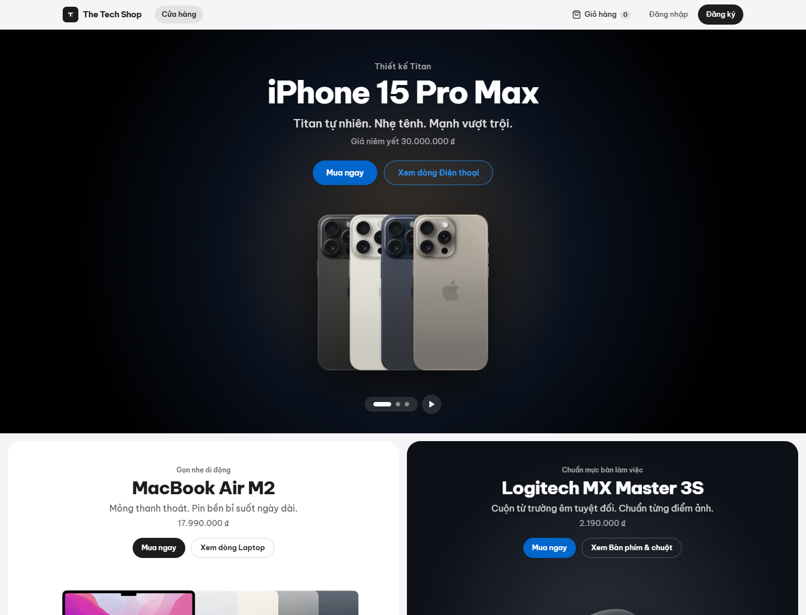
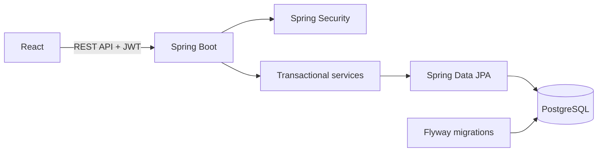

<h1 align="center">The Tech Shop</h1>

<p align="center">
  Cửa hàng thiết bị công nghệ — từ khám phá sản phẩm đến quản lý đơn hàng.
  <br />
  Xây dựng với React, Spring Boot và PostgreSQL.
</p>

<p align="center">
  <a href="https://github.com/conglam56/E-Commerce/actions/workflows/ci.yml"></a>
  
  
  
</p>

<p align="center">
  <a href="https://the-tech-shop-storefront.onrender.com/"><strong>Xem demo</strong></a>
  · <a href="https://the-tech-shop-storefront.onrender.com/swagger-ui/index.html">Tài liệu API</a>
  · <a href="#chạy-nhanh">Chạy nhanh</a>
  · <a href="https://github.com/conglam56/E-Commerce/actions">CI / Build</a>
</p>



The Tech Shop là dự án thương mại điện tử full-stack dành cho thiết bị và phụ kiện công nghệ. Khách hàng có thể tìm sản phẩm, quản lý giỏ hàng, đặt đơn và xem hồ sơ; quản trị viên quản lý danh mục, sản phẩm và tiến trình đơn hàng. Giá và tồn kho được kiểm tra ở backend khi đặt đơn.

> **Demo online:** [the-tech-shop-storefront.onrender.com](https://the-tech-shop-storefront.onrender.com/). Đăng ký tài khoản để dùng thử. Demo chạy trên Render Free nên lần truy cập đầu sau một thời gian không hoạt động có thể cần chờ khởi động.

## Mục lục

- [Tính năng](#tính-năng)
- [Giao diện](#giao-diện)
- [Công nghệ và kiến trúc](#công-nghệ-và-kiến-trúc)
- [Chạy nhanh](#chạy-nhanh)
- [Phát triển cục bộ](#phát-triển-cục-bộ)
- [Cấu hình](#cấu-hình)
- [Tài khoản và phân quyền](#tài-khoản-và-phân-quyền)
- [Kiểm tra và đóng gói](#kiểm-tra-và-đóng-gói)
- [Triển khai](#triển-khai)
- [Cấu trúc dự án](#cấu-trúc-dự-án)
- [Phạm vi demo](#phạm-vi-demo)

## Tính năng

| Khu vực | Chức năng |
| --- | --- |
| **Cửa hàng** | Sản phẩm nổi bật, tìm kiếm, lọc danh mục, sắp xếp giá và phân trang phía server |
| **Chi tiết sản phẩm** | Thư viện ảnh, mô tả, thông số tham khảo, giá và tồn kho; nhập số lượng trực tiếp hoặc dùng nút tăng/giảm |
| **Tài khoản** | Đăng ký, đăng nhập bằng JWT, avatar chữ cái và hồ sơ cá nhân |
| **Mật khẩu** | Kiểm tra ngay khi nhập ở đăng ký và đổi mật khẩu; tối thiểu 6 ký tự, xác nhận mật khẩu và kiểm tra mật khẩu hiện tại ở server |
| **Giỏ hàng** | Thêm, cập nhật số lượng, xóa sản phẩm và tính tổng tiền ở backend |
| **Đơn hàng** | Đặt hàng COD, xem lịch sử và chi tiết đơn, hủy đơn đủ điều kiện |
| **Quản trị** | Quản lý sản phẩm, danh mục và cập nhật trạng thái đơn hàng; kiểm tra quyền ADMIN tại API |
| **Toàn vẹn dữ liệu** | Transaction khi đặt/hủy đơn, lưu giá tại thời điểm đặt, trừ/hoàn tồn kho và optimistic locking để phát hiện xung đột |

Luồng đơn hàng: `PENDING → CONFIRMED → SHIPPED → DELIVERED`. Khách hàng có thể hủy đơn `PENDING`; quản trị viên có thể hủy đơn `PENDING` hoặc `CONFIRMED`. Hủy thành công sẽ hoàn lại tồn kho.

## Giao diện

Giao diện sử dụng logo khối mở mới, cùng hệ thống nút bấm và biểu mẫu thống nhất. Trang chủ có thanh tìm kiếm nhanh, sản phẩm nổi bật, danh mục và lưới sản phẩm. Trang chi tiết hỗ trợ nhiều góc nhìn sản phẩm. Giao diện thích ứng với màn hình máy tính và điện thoại, có trạng thái tải, lỗi và dữ liệu trống; hộp thoại quản lý sản phẩm hỗ trợ thao tác bằng bàn phím.

Các ảnh bên dưới và ảnh trang chủ phía trên được chụp từ giao diện hiện tại với dữ liệu minh họa; thông tin tài khoản và đơn hàng trong ảnh không phải dữ liệu khách hàng thật.

| Đặt hàng | Quản lý đơn hàng |
| --- | --- |
|  |  |

[Xem giao diện đặt hàng trên điện thoại](docs/screenshots/checkout-mobile.png)

## Công nghệ và kiến trúc

| Thành phần | Công nghệ |
| --- | --- |
| Frontend | React 18, React Router, Vite 6, Tailwind CSS 4, Axios, Lucide |
| Backend | Java 17, Spring Boot 3.2, Spring Security, JWT, BCrypt |
| Dữ liệu | PostgreSQL 16, Spring Data JPA, Flyway, MapStruct |
| Kiểm thử | JUnit 5, Mockito |
| CI / Triển khai | GitHub Actions, Docker multi-stage, Render |



Trong môi trường phát triển, Vite chuyển tiếp `/api` đến Spring Boot. Trên Render, React được build vào ứng dụng Spring Boot để giao diện và API dùng chung tên miền.

## Chạy nhanh

**Yêu cầu:** Git và Docker Desktop có Docker Compose.

```sh
git clone https://github.com/conglam56/E-Commerce.git
cd E-Commerce
```

Sao chép cấu hình mẫu bằng PowerShell:

```powershell
Copy-Item .env.example .env
```

Điền `DB_PASSWORD` và `JWT_SECRET` trong `.env`. Dùng lệnh dưới đây để tạo khóa JWT ngẫu nhiên, rồi sao chép kết quả vào `JWT_SECRET`:

```powershell
$jwtBytes = New-Object byte[] 48
$jwtRng = [Security.Cryptography.RandomNumberGenerator]::Create()
$jwtRng.GetBytes($jwtBytes)
[Convert]::ToBase64String($jwtBytes)
$jwtRng.Dispose()
```

Khởi động toàn bộ ứng dụng:

```sh
docker compose up -d --build
docker compose ps
```

Mở **[localhost:3000](http://localhost:3000)**. Flyway tự khởi tạo schema và catalog mẫu khi backend kết nối database mới.

| Dịch vụ | Địa chỉ |
| --- | --- |
| Giao diện Docker | [localhost:3000](http://localhost:3000) |
| REST API | [localhost:8080/api](http://localhost:8080/api) |
| Swagger UI | [localhost:8080/swagger-ui/index.html](http://localhost:8080/swagger-ui/index.html) |
| PostgreSQL | `localhost:5434`, database `e-commerce` |

## Phát triển cục bộ

**Yêu cầu:** JDK 17+, Maven 3.9+, Node.js 22+ và PostgreSQL. Chuẩn bị `.env` như phần [Chạy nhanh](#chạy-nhanh).

Chạy PostgreSQL bằng Docker, sau đó khởi động backend từ thư mục gốc:

```sh
docker compose up -d postgres mailbox
mvn spring-boot:run
```

Mở terminal khác để chạy frontend:

```sh
cd frontend
npm ci
npm run dev
```

Truy cập **[localhost:5173](http://localhost:5173)**. Vite mặc định proxy `/api` đến `http://localhost:8080`.

Nếu đang chạy toàn bộ stack bằng Docker, dừng hai dịch vụ ứng dụng trước khi chạy Maven và Vite để tránh trùng cổng:

```sh
docker compose stop frontend backend
```

## Cấu hình

Spring Boot đọc `.env` khi được chạy từ thư mục gốc. Biến môi trường của tiến trình có thể ghi đè các giá trị trong tệp. `.env` được Git bỏ qua; chỉ commit tệp mẫu [.env.example](.env.example).

| Biến | Mục đích | Giá trị / lưu ý |
| --- | --- | --- |
| `DB_URL` | JDBC URL PostgreSQL | Cục bộ: `jdbc:postgresql://localhost:5434/e-commerce` |
| `DB_USERNAME` | Người dùng database | Tệp mẫu dùng `postgres` |
| `DB_PASSWORD` | Mật khẩu database | Tự thiết lập trong môi trường chạy |
| `JWT_SECRET` | Khóa ký JWT dạng Base64 | Ít nhất 32 byte ngẫu nhiên trước khi mã hóa |
| `JWT_EXPIRATION` | Thời hạn JWT, mili giây | `3600000` tương đương 1 giờ |
| `VITE_API_BASE_URL` | Địa chỉ API khi build frontend | Mặc định `/api`; đặt khi dùng API ở host khác |
| `DEMO_ADMIN_EMAIL` | Email tài khoản demo cần cấp quyền ADMIN khi backend khởi động | Tùy chọn; tài khoản phải đã đăng ký và đang hoạt động |

### Xác minh email và khôi phục mật khẩu

Khách vẫn đăng nhập ngay sau khi đăng ký. Mở liên kết trong thư, đăng nhập đúng tài khoản rồi chọn **Xác minh email** trong vòng 24 giờ. Tài khoản đã tạo trước bản cập nhật có thể yêu cầu thư xác minh trong **Hồ sơ**. Mỗi địa chỉ có thể yêu cầu gửi lại sau một phút.

Tại màn hình đăng nhập, chọn **Quên mật khẩu?** để nhận liên kết qua email đã xác minh. Liên kết có hiệu lực 15 phút và dùng được một lần. Khi đặt lại mật khẩu thành công, khách cần đăng nhập lại trên tất cả thiết bị.

- **Docker cục bộ** tự chuyển thư đến [hộp thư thử nghiệm](http://localhost:8025). Mở địa chỉ này để xem danh sách thư dạng JSON và sao chép toàn bộ liên kết trong trường `text`, kể cả phần sau dấu `#`. Hộp thư lưu trong bộ nhớ và chỉ dùng với tài khoản thử nghiệm.
- **Maven và Vite** dùng cùng hộp thư khi chạy dịch vụ Compose `mailbox` và bật bốn biến dành cho phát triển trong bản sao `.env` của `.env.example`.
- **Render** gửi thư qua Resend HTTPS. Trong Environment của Web Service, đặt `RESEND_API_KEY` và `ACCOUNT_MAIL_FROM` với địa chỉ gửi thuộc tên miền đã xác minh trên Resend. Liên kết mặc định dùng `RENDER_EXTERNAL_URL`. Đặt `ACCOUNT_PUBLIC_URL` thành địa chỉ HTTPS của cửa hàng nếu dùng tên miền riêng. `ACCOUNT_MAIL_ENDPOINT` mặc định là `https://api.resend.com/emails`.

## Tài khoản và phân quyền

Tài khoản đăng ký qua giao diện có quyền **CUSTOMER**. Chọn avatar trên thanh điều hướng để xem họ tên, email, vai trò và đổi mật khẩu.

Demo online có tài khoản quản trị được cấu hình riêng; thông tin truy cập được cung cấp trực tiếp cho người dùng thử quản trị.

<details>
<summary><strong>Tạo quản trị viên trên máy</strong></summary>

Đăng ký một tài khoản qua giao diện, rồi mở PostgreSQL cục bộ:

```sh
docker compose exec postgres psql -U postgres -d e-commerce
```

Thay email bên dưới bằng tài khoản vừa đăng ký. Dùng username database đã cấu hình nếu khác `postgres`.

```sql
UPDATE users SET role = 'ADMIN' WHERE email = 'your-demo-admin@example.com';
```

Đăng xuất rồi đăng nhập lại để nhận quyền mới. Khi triển khai demo, có thể dùng biến môi trường `DEMO_ADMIN_EMAIL` thay cho thao tác SQL; mật khẩu hiện có được giữ nguyên.

</details>

## Kiểm tra và đóng gói

| Mục tiêu | Lệnh | Thư mục |
| --- | --- | --- |
| Chạy test backend | `mvn test` | Gốc repository |
| Kiểm tra và đóng gói backend | `mvn verify` | Gốc repository |
| Chạy unit test, test tích hợp PostgreSQL và đóng gói | `mvn -Pintegration verify` | Gốc repository |
| Cài dependency frontend | `npm ci` | `frontend` |
| Build frontend | `npm run build` | `frontend` |
| Chạy test giao diện với backend và PostgreSQL thật | `npm run test:e2e` | `frontend` |

Test backend dùng JUnit và Mockito, không cần database cho `mvn test`. Các test kiểm tra xác thực, điều kiện đăng ký, cấp quyền admin demo, giỏ hàng, quy trình đặt/hủy đơn và xung đột tồn kho.

Test tích hợp trong `OrderPostgresIT` dùng PostgreSQL 16 thật qua Testcontainers và chạy toàn bộ migration Flyway. Cần Docker Engine đang chạy (Docker Desktop ở chế độ Linux containers trên Windows); lần chạy đầu cần tải image và dependency. Testcontainers tự tạo database riêng, cấp cổng ngẫu nhiên và dọn container sau khi chạy, không sử dụng database hay thông tin đăng nhập trong `.env`.

Các test tích hợp kiểm tra đặt đơn và lưu giá mua, rollback khi thiếu hàng hoặc lỗi ràng buộc database, hai khách cùng mua sản phẩm cuối chỉ có một đơn thành công, giỏ hàng của khách thất bại được giữ lại và hủy đơn chỉ hoàn kho một lần. Các ca kiểm tra trạng thái đã commit bằng truy vấn PostgreSQL ngoài transaction của service. Riêng ca đồng thời cho hai transaction cùng đọc tồn kho bằng 1 trước khi checkout để kiểm tra xung đột optimistic locking thực tế.

`mvn test` và `mvn verify` không yêu cầu Docker; dùng `mvn -Pintegration verify` để chạy thêm test tích hợp. Khi đã bật profile `integration`, thiếu Docker hoặc test tích hợp thất bại sẽ làm build thất bại, không tự bỏ qua test.

Test giao diện dùng Playwright Test (JavaScript) với Chromium. Cài dependency và trình duyệt lần đầu từ thư mục `frontend`:

```sh
npm ci
npx playwright install chromium
npm run test:e2e
```

Trên Linux, dùng `npx playwright install --with-deps chromium` để cài thêm thư viện hệ thống. Cần Docker Engine chạy Linux containers. Lệnh E2E build ứng dụng bằng `Dockerfile.render`, chạy cùng PostgreSQL riêng qua `compose.e2e.yml`, dùng tên project và cổng localhost ngẫu nhiên rồi dọn container sau khi chạy. Database nằm trong bộ nhớ tạm của container; không dùng volume, database hoặc `.env` phát triển. Mật khẩu test và khóa JWT sinh ngẫu nhiên, chỉ truyền qua môi trường của tiến trình.

Các ca E2E kiểm tra đăng ký, đăng xuất/đăng nhập, cập nhật giỏ hàng, đặt COD và hủy đơn; chuyển khách chưa đăng nhập tới trang đăng nhập; chặn khách hàng tại trang/API quản trị; admin cập nhật trạng thái đơn; và ngăn người khác xem/hủy đơn không thuộc tài khoản mình. API và database đều chạy thật. Chỉ bước chuẩn bị cấp quyền admin cập nhật database test bằng truy vấn có tham số.

Báo cáo nằm ở `frontend/playwright-report`; screenshot và trace được giữ lại khi test lỗi trong `frontend/test-results`. Xem báo cáo bằng `npx playwright show-report` từ `frontend`. Có thể chạy một ca bằng `npm run test:e2e -- --grep "customer registers"`. Bộ E2E hiện kiểm tra Chromium trên desktop.

[GitHub Actions](.github/workflows/ci.yml) chạy `mvn -Pintegration verify`, build frontend và chạy E2E cho mỗi push hoặc pull request; báo cáo Playwright được lưu làm artifact trong 7 ngày.

Sau `mvn verify`, chạy backend đã đóng gói với cấu hình database trong `.env`:

```sh
java -jar target/ecommerce-0.0.1-SNAPSHOT.jar
```

Bộ kiểm thử khôi phục tài khoản kiểm tra thời hạn, gửi lại và sử dụng đồng thời trên PostgreSQL. Playwright mở liên kết từ hộp thư thử nghiệm, xác minh email, đặt lại mật khẩu và kiểm tra phiên cũ bị từ chối.

## Thanh toán thử nghiệm và vận đơn

VNPay Sandbox xuất hiện trong trang đặt hàng khi backend có `VNPAY_TMN_CODE` và `VNPAY_HASH_SECRET`. Lấy hai giá trị từ tài khoản merchant Sandbox của bạn và đặt trong `.env` hoặc Environment của Render. Đặt `ACCOUNT_PUBLIC_URL` thành địa chỉ cửa hàng. Khi dùng Docker cục bộ, Compose truyền hai biến VNPay vào backend.

Đăng ký URL thông báo IPN với VNPay bằng địa chỉ HTTPS `https://<ten-mien-cua-hang>/api/payments/vnpay/ipn`. URL quay về là `https://<ten-mien-cua-hang>/orders`. Máy chủ nhận IPN phải được VNPay truy cập từ Internet. Tham khảo [tài liệu tích hợp VNPay](https://sandbox.vnpayment.vn/apis/docs/thanh-toan-pay/pay.html).

Sau khi đặt đơn VNPay, khách có 15 phút để thanh toán qua nút trong đơn vừa đặt hoặc **Đơn hàng của tôi**. Số tiền lấy từ đơn đã lưu trên server. Chỉ IPN có chữ ký HMAC-SHA512 hợp lệ, đúng merchant và đúng số tiền mới ghi nhận kết quả. Tham số trả về trên trình duyệt dùng để điều hướng về danh sách đơn.

Thông báo thành công chuyển đơn sang **Đã xác nhận** và **Đã thanh toán**. Thông báo lặp được nhận diện dưới khóa database để bảo đảm chỉ cập nhật một lần. Đơn thanh toán thất bại được hủy và hoàn kho. Tác vụ chạy mỗi phút xử lý tối đa 20 đơn quá hạn và hoàn kho một lần cho mỗi đơn. Đơn quá hạn được cập nhật khi tác vụ định kỳ xử lý đến đơn đó.

Nếu thành công thanh toán đến sau khi đơn đã hủy hoặc ngoài thời hạn, đơn được đánh dấu **Cần đối soát thanh toán với cửa hàng**. Admin đối chiếu giao dịch ở VNPay trước khi xử lý. Đơn VNPay đã trả tiền được chặn hủy qua API hiện tại, vì việc hủy cần đi cùng quy trình hoàn tiền.

Trong **Quản lý đơn hàng**, admin nhập hãng vận chuyển và mã vận đơn cho đơn đã xác nhận hoặc đang giao. Khách xem thông tin này trong đơn của mình. Dữ liệu đơn cũ tiếp tục hiển thị bình thường. Vận đơn được admin cập nhật thủ công, còn phí giao hàng của demo đang là miễn phí.

Test `VnpayPostgresIT` kiểm tra IPN đồng thời, chữ ký và số tiền sai, hoàn kho, hết hạn và thanh toán đến sau hủy. E2E dùng khóa ngẫu nhiên cho stack riêng, ký IPN giả lập bằng Node.js để kiểm tra backend, xác thực URL thanh toán và chạy giao diện lưu vận đơn. Khi chạy với credential VNPay Sandbox thật, cần kiểm tra thêm giao dịch qua trang ngân hàng thử nghiệm và IPN do VNPay gửi.

## Công cụ vận hành admin

Admin mở **Tổng quan** trên thanh điều hướng để xem doanh thu, số đơn đã giao, số đơn theo từng trạng thái và sản phẩm cần bổ sung tồn kho. Nút **Làm mới** tải lại dữ liệu.

- Doanh thu là tổng `orders.total_amount` của toàn bộ đơn hiện có trạng thái `DELIVERED`, trên toàn bộ thời gian. Mỗi đơn được tính một lần bằng giá trị đã lưu khi đặt hàng. Các đơn thử nghiệm, gồm VNPay Sandbox và chuyển khoản mô phỏng, cũng được tính khi đã giao.
- Cảnh báo tồn kho gồm sản phẩm đang hoạt động, thuộc danh mục đang hoạt động và có số lượng tối đa **5**, bao gồm số lượng bằng 0. Danh sách sắp theo tồn kho tăng dần và có phân trang.
- Trong **Quản lý đơn hàng**, mở **Lịch sử trạng thái** trên từng đơn để xem các thay đổi mới nhất và thời điểm ghi nhận. Lịch sử lưu trạng thái trước/sau và thời điểm, với 20 bản ghi mỗi trang.

Migration V12 ghi một mốc **Trạng thái khi bật lịch sử** cho mỗi đơn cũ tại thời điểm nâng cấp. Từ đó, trigger PostgreSQL tự ghi việc tạo đơn và những lần trạng thái thay đổi, bao gồm thao tác của admin, khách hàng và hệ thống thanh toán. Bản ghi lịch sử được lưu cùng transaction với thay đổi đơn hàng. Cập nhật lặp lại cùng trạng thái và cập nhật vận đơn giữ nguyên trạng thái sẽ giữ nguyên lịch sử. [Cơ chế trigger PostgreSQL](https://www.postgresql.org/docs/16/plpgsql-trigger.html).

API mới nằm dưới quyền admin:

- `GET /api/admin/operations` trả số liệu tổng quan.
- `GET /api/admin/operations/low-stock?page=0&size=20` trả sản phẩm sắp hết hàng.
- `GET /api/admin/orders/{id}/history?page=0&size=20` trả lịch sử trạng thái.

Hai API phân trang nhận `page >= 0`, `1 <= size <= 100`. Bộ tích hợp kiểm tra số liệu đối chiếu, tồn kho ở biên cảnh báo, rollback, cập nhật đồng thời và nâng cấp từ schema V11 có dữ liệu cũ. E2E kiểm tra giao diện desktop/mobile, phân quyền và lịch sử từ callback VNPay.

## Triển khai

**Demo:** [the-tech-shop-storefront.onrender.com](https://the-tech-shop-storefront.onrender.com/)

[render.yaml](render.yaml) khai báo một Web Service và một PostgreSQL riêng. [Dockerfile.render](Dockerfile.render) build React, đưa tài nguyên frontend vào Spring Boot, chạy `mvn verify` và tạo image chạy ứng dụng.

Web Service và Blueprint của demo theo dõi nhánh **`main`**, với **Auto-Deploy: On Commit**. Push hoặc merge vào `main` sẽ kích hoạt Render build và kiểm tra sức khỏe trước khi cập nhật ứng dụng tại cùng URL.

Để triển khai trên tài khoản Render khác:

1. Tạo Blueprint từ repository này, chọn nhánh `main` và tệp `render.yaml`.
2. Render tạo PostgreSQL, liên kết thông tin kết nối và sinh khóa JWT từ Blueprint.
3. Sau khi deploy thành công, đăng ký tài khoản qua giao diện.
4. Nếu cần quản trị demo, thêm `DEMO_ADMIN_EMAIL` trong Environment của Web Service và deploy lại.

Xem [giới hạn Render Free](https://render.com/docs/free) trước khi dùng dịch vụ và database miễn phí lâu dài.

## Cấu trúc dự án

```text
E-Commerce/
├── frontend/
│   ├── public/catalog/            # Ảnh catalog và thông tin nguồn ảnh
│   └── src/
│       ├── components/            # Navbar, avatar, ảnh sản phẩm, form dùng chung
│       ├── context/               # Trạng thái xác thực và giỏ hàng
│       ├── pages/                 # Cửa hàng, hồ sơ, đơn hàng, quản trị
│       └── utils/                 # Định dạng và nội dung catalog
├── src/main/java/com/javaweb/ecommerce/
│   ├── controller/                # REST endpoints
│   ├── service/                   # Nghiệp vụ và transaction
│   ├── repository/                # Truy cập dữ liệu qua JPA
│   └── security/                  # Spring Security và JWT
├── src/main/resources/db/migration/ # Schema và dữ liệu mẫu Flyway
├── src/test/                      # Test backend
├── docs/screenshots/              # Ảnh giao diện
├── .github/workflows/ci.yml        # Kiểm tra tự động
├── docker-compose.yml             # Stack phát triển cục bộ
└── render.yaml                    # Hạ tầng demo trên Render
```

## Phạm vi demo

COD là luồng đặt hàng chính; chuyển khoản thủ công chỉ mô phỏng lựa chọn thanh toán. VNPay được tích hợp ở môi trường Sandbox và cần credential merchant để bật. Vận đơn được quản lý thủ công. Đặt vận chuyển qua API hãng giao hàng, hoàn tiền tự động và email thông báo đơn hàng là những phần còn cần tích hợp. Dùng thông tin giao hàng minh họa khi thử đặt đơn trên demo công khai.

Ảnh và thông số catalog phục vụ minh họa sản phẩm. Ảnh có nguồn từ CDN và có ảnh dự phòng khi không tải được; xem [thông tin nguồn ảnh](frontend/public/catalog/photo-credits.html).
