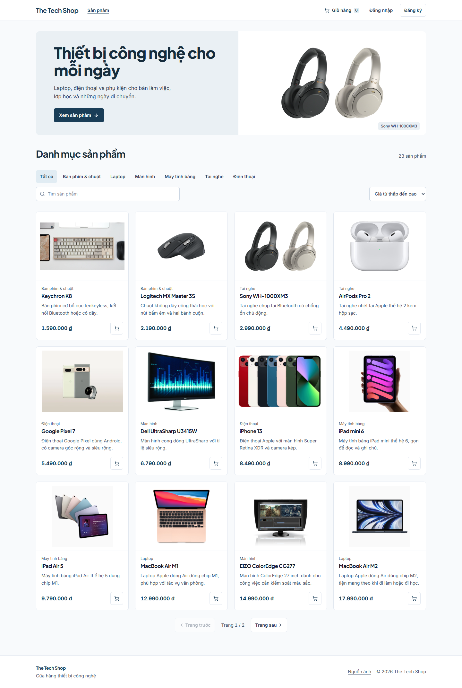
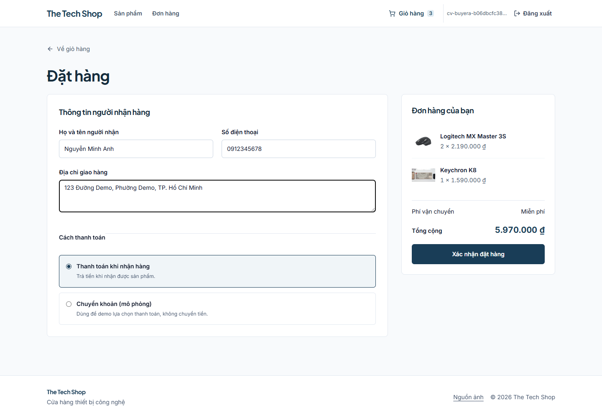
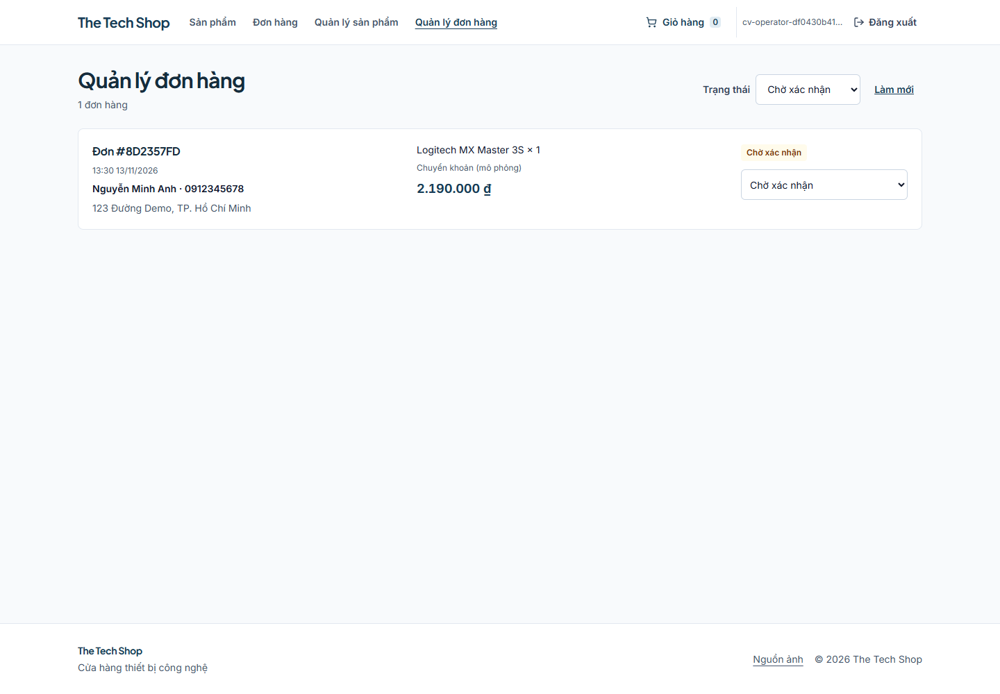

# The Tech Shop

Ứng dụng bán thiết bị công nghệ với React và Spring Boot. Khách có thể tìm sản phẩm, quản lý giỏ, đặt hàng và hủy đơn đang chờ xác nhận. Quản trị viên quản lý sản phẩm và xử lý đơn theo từng trạng thái.

Bản demo có 23 sản phẩm mẫu thuộc 6 danh mục. Giá và tồn kho là dữ liệu minh họa. Chuyển khoản là mô phỏng.

## Công nghệ

| Phần | Công nghệ |
| --- | --- |
| Backend | Java 17+, Spring Boot 3.2, Spring Security, JWT, BCrypt |
| Dữ liệu | PostgreSQL, Spring Data JPA, Flyway, MapStruct |
| Frontend | React 18, React Router, Vite 6, Tailwind CSS 4, Axios |
| Kiểm tra | JUnit 5, Mockito, kiểm thử API và trình duyệt trên dữ liệu QA |
| CI | GitHub Actions với hai job kiểm tra backend và build frontend |

## Các phần đã triển khai

- Phân quyền CUSTOMER/ADMIN ở API và điều hướng tương ứng ở giao diện.
- Tìm kiếm, lọc danh mục, sắp xếp và phân trang phía máy chủ.
- Thay đổi số lượng trong giỏ, kiểm tra tồn kho và tính tiền phía backend.
- Đặt hàng trong transaction, lưu giá tại thời điểm đặt, trừ kho và làm trống giỏ khi thành công.
- Optimistic locking trên sản phẩm và đơn hàng. Cập nhật xung đột trả HTTP 409 và transaction được rollback.
- Hủy đơn còn chờ xác nhận và hoàn tồn kho. Quản trị có thể hủy đơn đã xác nhận trước khi giao.
- Giao diện responsive với trạng thái đang tải, lỗi, thử lại và giỏ trống.
- Ảnh catalog hãng cho 22 sản phẩm, có ảnh dự phòng khi CDN lỗi. Một sản phẩm Xiaomi vẫn dùng ảnh dự phòng. Nguồn được liệt kê tại trang “Nguồn ảnh” ở chân trang.

~~~mermaid
flowchart LR
    Browser[React] -->|REST + JWT| API[Spring Boot]
    API --> Security[Spring Security]
    API --> Services[Transactional services]
    Services --> JPA[JPA + optimistic locking]
    JPA --> DB[(PostgreSQL)]
    Flyway[Flyway migrations] --> DB
~~~

## Chạy trên máy

Cần JDK 17 trở lên, Maven 3.9 trở lên, Node.js 22 trở lên và PostgreSQL. Docker Compose có thể dùng để chạy riêng PostgreSQL.

### 1. Chuẩn bị cấu hình

Từ thư mục gốc của repo, sao chép tệp mẫu.

~~~powershell
Copy-Item .env.example .env
~~~

Điền `DB_PASSWORD` bằng mật khẩu cục bộ của bạn. Tạo khóa JWT bằng PowerShell, rồi điền kết quả vào `JWT_SECRET`.

~~~powershell
$jwtBytes = New-Object byte[] 48
$jwtRng = [Security.Cryptography.RandomNumberGenerator]::Create()
$jwtRng.GetBytes($jwtBytes)
[Convert]::ToBase64String($jwtBytes)
$jwtRng.Dispose()
~~~

Spring Boot tự đọc `.env` khi chạy từ thư mục gốc. Biến môi trường của tiến trình có thể ghi đè các giá trị trong tệp. `.env` được Git bỏ qua.

### 2. Chạy cơ sở dữ liệu

~~~sh
docker compose up -d postgres
docker compose ps
~~~

PostgreSQL được ánh xạ vào cổng `5434`, database `e-commerce`. Nếu dùng PostgreSQL có sẵn, điều chỉnh `DB_URL`, `DB_USERNAME` và `DB_PASSWORD` cho đúng database đó.

Flyway áp dụng schema và dữ liệu mẫu khi backend khởi động. Hãy dùng một database riêng cho demo.

### 3. Chạy backend

~~~sh
mvn spring-boot:run
~~~

API nằm tại `http://localhost:8080/api`.

### 4. Chạy frontend trong terminal khác

~~~sh
cd frontend
npm ci
npm run dev
~~~

Mở `http://localhost:5173`. Frontend mặc định gọi `/api` qua proxy Vite. Khi cần một API ở host khác, đặt `VITE_API_BASE_URL` trong môi trường build frontend.

## Demo vai trò quản trị

Đăng ký một tài khoản mới qua giao diện. Trong database demo, cấp quyền cho đúng email đã đăng ký.

~~~sh
docker compose exec postgres psql -U postgres -d e-commerce
~~~

~~~sql
UPDATE users SET role = 'ADMIN' WHERE email = 'your-demo-admin@example.com';
~~~

Dùng username database bạn cấu hình nếu khác `postgres`. Đăng xuất rồi đăng nhập lại để giao diện nhận quyền mới. Tài khoản đăng ký thông thường có quyền CUSTOMER.

## Kịch bản trình bày

1. Tìm sản phẩm, đổi danh mục và sắp xếp giá.
2. Đăng ký tài khoản khách, thêm hai sản phẩm và đổi số lượng trong giỏ.
3. Nhập thông tin giao hàng, chọn COD và đặt đơn.
4. Mở lịch sử đơn, đối chiếu tổng tiền, hủy một đơn đang chờ xác nhận và kiểm tra tồn kho.
5. Đăng nhập quản trị, lọc đơn và chuyển qua các trạng thái hợp lệ.
6. Thử truy cập API quản trị bằng tài khoản khách để thấy HTTP 403.

~~~text
PENDING -> CONFIRMED -> SHIPPED -> DELIVERED
PENDING -> CANCELLED
CONFIRMED -> CANCELLED
~~~

Một đơn đang giao chỉ có thể chuyển sang đã giao. Trạng thái kết thúc được giữ khi gửi lặp cùng cập nhật. Chuyển khoản mô phỏng chỉ ghi nhận lựa chọn thanh toán, không xác minh giao dịch ngân hàng.

## Kiểm tra và đóng gói

~~~sh
mvn test
mvn verify
cd frontend
npm ci
npm run build
~~~

JAR được tạo ở `target/ecommerce-0.0.1-SNAPSHOT.jar`. Có thể chạy bằng lệnh sau từ thư mục gốc, với cấu hình database đã chuẩn bị.

~~~sh
java -jar target/ecommerce-0.0.1-SNAPSHOT.jar
~~~

Bộ test dùng Mockito nên không cần database cho `mvn test`. Surefire nạp Java agent từ dependency để chạy được trên các JVM hạn chế dynamic attach.

Workflow ở [.github/workflows/ci.yml](.github/workflows/ci.yml) chạy `mvn verify` và `npm ci && npm run build` cho push và pull request.

## Bằng chứng kiểm tra

| Kiểm tra | Kết quả cục bộ |
| --- | --- |
| JUnit/Mockito | 36 test đạt, gồm 15 test cũ và 21 ca hồi quy mới |
| Đóng gói | `mvn verify` tạo JAR thành công, JAR khởi động được |
| Frontend từ lockfile | `npm ci` và `npm run build` thành công |
| Phân quyền và validation | Kiểm tra HTTP 401, 403, 409 và 400 qua API |
| Hai khách mua sản phẩm cuối cùng | Đối chiếu đơn thắng, đơn thất bại và số lượng tồn kho |
| Giao dịch đặt/hủy đơn | Đối chiếu tổng tiền, giỏ hàng và tồn kho |
| Trình duyệt | COD, chuyển khoản mô phỏng, lịch sử khách và xử lý đơn quản trị |
| Responsive | Kiểm tra tại 375, 390, 768, 1024 và 1440 px |

Kết quả cục bộ được kiểm tra ngày 13/11/2026. Các kiểm tra tích hợp dùng PostgreSQL QA cục bộ. Cấu hình Compose đã được kiểm tra bằng `docker compose config --quiet`. Trạng thái chạy CI trên GitHub sẽ xuất hiện sau khi code được đẩy lên repository.

## Ảnh demo

[Xem giao diện đặt hàng trên điện thoại](docs/screenshots/checkout-mobile.png)

## Nội dung cho CV

**The Tech Shop — Full-stack E-commerce Application**

*Java, Spring Boot, Spring Security, PostgreSQL, React, Tailwind CSS, GitHub Actions*

- Developed a full-stack storefront with JWT authentication, role-based access, server-side product filtering, cart management, checkout, and customer/admin order workflows.
- Implemented transactional checkout and inventory restoration with JPA optimistic locking, Flyway migrations, and 36 JUnit/Mockito tests; configured CI for backend verification and frontend production builds.

Có thể giải thích khi phỏng vấn cách transaction rollback giữ kho nhất quán, cách JWT và quyền ADMIN được kiểm tra ở server, và cách frontend hiển thị lỗi mà giữ dữ liệu người dùng đang nhập.

## Phạm vi demo

COD là luồng đặt hàng chính. Ngân hàng, vận chuyển và email chưa tích hợp dịch vụ thực tế. Ảnh hãng được tải từ CDN và có thể thay đổi theo nguồn. Repo chuẩn bị cho chạy cục bộ, cần cấu hình môi trường riêng nếu triển khai công khai.
